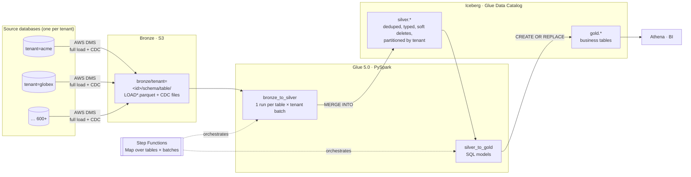

# aws-medallion-lakehouse

[](https://github.com/Jebason-Chellakumar/aws-medallion-lakehouse/actions/workflows/ci.yml)


A **multi-tenant CDC lakehouse on AWS**. It replicates hundreds of operational databases with AWS DMS and merges every change into **Apache Iceberg** tables using **Glue (PySpark)**. The result is served as Bronze → Silver → Gold layers you can query in **Athena**.

It's an open-source version of the architecture I've used in production to consolidate **600+ source databases** (MySQL, MongoDB/DocumentDB, DynamoDB) into one analytics platform. It contains no employer code or data.



## What makes this hard (and how it's solved)

| Problem at 600+ databases | Approach | Where |
|---|---|---|
| **Same primary key in every tenant DB** | Silver tables merge on `(tenant_id, pk)`, and tenant comes from the DMS `BucketFolder` (`tenant=<id>`) | [`spec.py`](lakehouse/spec.py) |
| **Many changes to one row in one batch.** MERGE fails if a target row matches more than one source row | Keep only the latest change per key with `ROW_NUMBER()`, ordered by commit timestamp, then file, then row position (handles two changes with the same timestamp) | [`sql.py · dedup_sql`](lakehouse/sql.py) |
| **Replays, retries, late files** | Apply a change only if it's at least as new as the stored row (`s._dms_ts >= t._dms_ts`), which makes the merge idempotent | [`sql.py · merge_sql`](lakehouse/sql.py) |
| **Deletes must not reappear** when an old file is reprocessed | Deletes are **soft** (`_is_deleted`), so the newer tombstone always wins | [`sql.py · merge_sql`](lakehouse/sql.py) |
| **Schema drift.** Older tenants lack newer columns | Each tenant's files are projected onto the declared schema, with missing columns becoming typed `NULL`s. Spark `mergeSchema` (DuckDB `union_by_name`) reads files written before and after a migration together | [`sql.py · projection_sql`](lakehouse/sql.py) |
| **Glue concurrency limits** | Tenants are hashed into N stable batches. Step Functions runs one Glue job per *(table, batch)* under a `MaxConcurrency` cap, so parallelism doesn't grow with the number of tenants | [`files.py · select_batch`](lakehouse/files.py), [`template.yaml`](infra/template.yaml) |
| **Parallel commits to one Iceberg table** | Each run does one MERGE (one commit), scoped to its own tenants (`t.tenant_id IN (…)`) on a tenant-partitioned table, plus commit retries | [`sql.py`](lakehouse/sql.py) |
| **Incremental processing without Glue bookmarks** | DMS CDC file names sort by time, so a per-(table, tenant) watermark object stores the last file processed. It's written only after the MERGE commits | [`files.py · select_new_files`](lakehouse/files.py) |

## Same SQL in production and on your laptop

All MERGE, dedup, projection and gold SQL is generated in a dialect shared by **Spark SQL** and **DuckDB**. The Glue jobs run it on Iceberg, and the test suite runs *the exact same statements* on DuckDB. So the CDC behaviour is tested in CI without an AWS account or a JVM.

```bash
python -m venv .venv && source .venv/bin/activate
pip install -e ".[dev]"

python -m local_lake.sample_data --out data   # DMS-style files for 3 tenants
python -m local_lake.pipeline --data data     # bronze -> silver -> gold, prints gold tables
pytest                                        # 42 tests: CDC semantics + end-to-end
```

The sample data deliberately includes the edge cases: repeated updates to one row in a single batch, two changes with the same commit timestamp, deletes, and a legacy tenant whose `orders` table has no `currency` column until a later migration adds it.

## Deploy to AWS

You need the AWS CLI with credentials. The stack creates S3 buckets (lake, artifacts, Athena results), the `silver` and `gold` Glue databases, two Glue 5.0 jobs, a Step Functions pipeline, an hourly EventBridge schedule (disabled by default), an Athena workgroup and an IAM role for DMS.

```bash
STACK=medallion-lakehouse AWS_REGION=ap-south-1 ./scripts/deploy.sh

# Try it with the sample data:
aws s3 sync data/bronze "s3://<LakeBucketName>/bronze/"
aws stepfunctions start-execution --state-machine-arn <PipelineArn> \
  --input '{"tables": ["customers", "orders"]}'
```

Then run [`athena/example_queries.sql`](athena/example_queries.sql) in the `<stack>-analytics` workgroup. It covers gold queries, Iceberg time travel, snapshot history and per-tenant freshness.

### Connecting real databases with DMS
Create **one S3 target endpoint per source database** using the `DmsS3TargetRoleArn` stack output:

```json
{
  "BucketName": "<LakeBucketName>",
  "BucketFolder": "bronze/tenant=<tenant-id>",
  "DataFormat": "parquet",
  "IncludeOpForFullLoad": true,
  "TimestampColumnName": "_dms_ts",
  "ParquetTimestampInMillisecond": true,
  "ServiceAccessRoleArn": "<DmsS3TargetRoleArn>"
}
```

Then add the table to [`conf/tables.json`](conf/tables.json) (primary key and typed columns) and redeploy. New gold models are plain `SELECT` statements in [`gold/`](gold/), built in file-name order.

## Repository layout

```
lakehouse/        engine-agnostic core (no dependencies), shipped to Glue as --extra-py-files
  spec.py           table contracts + strict identifier validation (SQL is generated)
  sql.py            projection, dedup, MERGE, DDL builders (Spark SQL / DuckDB)
  files.py          bronze layout, incremental file selection, tenant batching
glue_jobs/        bronze_to_silver.py, silver_to_gold.py
gold/             SQL models (run on Spark in AWS and on DuckDB locally)
infra/            CloudFormation: S3, Glue, Iceberg catalog, Step Functions, Athena, IAM
local_lake/       DuckDB runner + DMS-style sample data generator
tests/            CDC semantics, file selection, batching, end-to-end gold checks
```

## Design notes and trade-offs

- **Merge-on-read Iceberg v2.** Frequent small CDC merges write delete files instead of rewriting data files. Run `rewrite_data_files` / `expire_snapshots` maintenance on a schedule (a natural next step).
- **Partitioning by `tenant_id`** keeps each batch's MERGE inside its own partitions. With thousands of very small tenants, `bucket(N, tenant_id)` would avoid tiny files.
- **Gold is rebuilt in full** (`CREATE OR REPLACE`). That's simple and correct at this size. Large models would become incremental MERGEs keyed on changed tenants.
- **Watermarks in S3, not Glue bookmarks.** The state is explicit, easy to inspect, and easy to reset per tenant (delete one object to reprocess a database).

## License
MIT. Built by [Jebason Chellakumar](https://www.linkedin.com/in/jebason-chellakumar), Cloud Solutions Architect (AWS Certified Solutions Architect – Associate).
